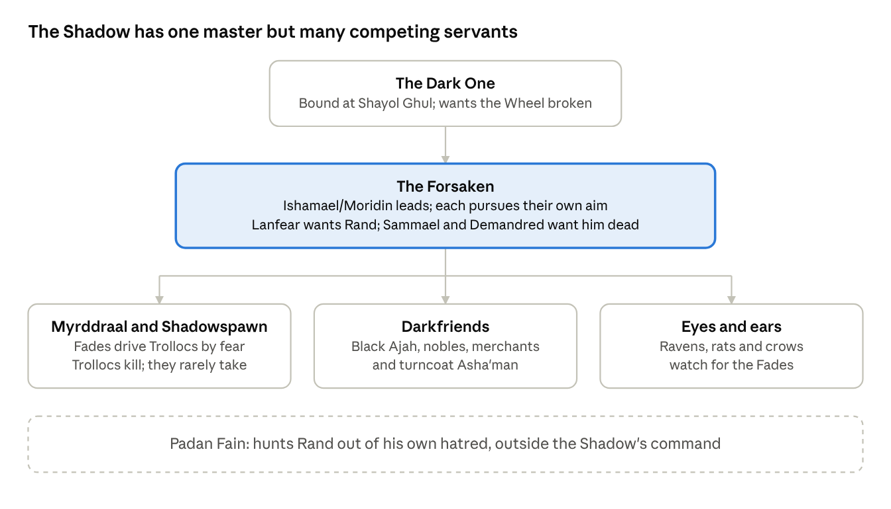

# WoT Thread — The Shadow

Oct 12, 2026 · @OncleMarcel

Up: [Wheel of Time — Story Map](../story-map.md) · Chapter cards: [EotW Ch. 1 — An Empty Road](../chapters/b01-eye-of-the-world/ch01-an-empty-road.md) · World: [WoT — World Index](../world/index.md)

The Shadow wants the Dragon Reborn turned, settles for him dead, and keeps sending servants who can only kill. That gap between what it wants and the tools it has drives the threat to Rand in every book. The reason is partly cosmic (a dead Dragon is reborn; a turned one wins the war) and partly that the Shadow never speaks with one voice.

## Who serves the Shadow

Orders pass from the Dark One through the Forsaken to servants who can find Rand (spies, Darkfriends) or kill him (Shadowspawn), but rarely take him. Each Forsaken bends those orders toward their own aim.

## What the Shadow wants from Rand

Turning Rand is the prize, capturing him is the means, and killing him is the fallback. The tools it has mostly do the last.

| Goal | What it gets the Shadow | Who leans this way | The catch |
| --- | --- | --- | --- |
| Turn him | The Dragon fights for the Shadow: the Last Battle is won, perhaps the Wheel itself broken | The Dark One; Ishamael/Ba'alzamon, later Moridin | Needs his consent, so it works through dreams, despair and temptation, not force |
| Capture him | A prisoner to break or bargain with; a step toward turning | Ishamael in Book 1; Lanfear, who wants him for herself | Trollocs and Fades are poor jailers, and his ta'veren pull bends events around him |
| Kill him | Removes him for this turning of the Wheel | Sammael, Demandred, many Darkfriends, panicking Myrddraal | A dead Dragon is spun out again: it delays the Last Battle, it doesn't win it |

**Why the Winternight raid looks contradictory.** The Shadow knows the Dragon is a young man of the Two Rivers but not which one, so a raid on the right houses is a dragnet. Trollocs kill by nature, and an order to take someone alive rarely survives a fight. For the Shadow, a dead village and even a dead Dragon are acceptable losses on the way to the prize.

The Light searches the same way. In [EotW Ch. 2 — Strangers](../chapters/b01-eye-of-the-world/ch02-strangers.md), Moiraine asks the villagers about ages, families and how long they have lived in the Two Rivers: both sides arrive on the same day, looking for the same young man, without knowing which one he is.

## Book by book

The Shadow's approach to Rand moves from brute hunting to inner corruption, while its leaders fight each other. The Goal column shows what each move is really after.

| Books | The Shadow's moves against Rand | Goal | What it teaches |
| --- | --- | --- | --- |
| 1 | A Myrddraal watches the boys; Trollocs raid Winternight; Fades, Draghkar and Darkfriends hunt them; Ba'alzamon speaks in dreams; Aginor and Balthamel wait at the Eye | Taken or dead; turned in the dreams | The Shadow doesn't know which boy; brute tools serve a subtle aim |
| 2–3 | Ba'alzamon's offers and threats; the duel over Falme; Rand kills him in the Heart of the Stone | Turned | The tempter's voice is the real danger, and Rand's own fear feeds it |
| 4–5 | Lanfear courts him; Asmodean is forced to teach him; Rahvin and Sammael plot; Rand kills Rahvin | Taken (Lanfear); dead (Rahvin, Sammael) | The Forsaken work against each other as much as against him |
| 6–7 | The Forsaken's word is to spread chaos; Sammael dies at Shadar Logoth | Chaos | When no one can kill him, the Shadow breaks the world around him instead |
| 8–9 | Turncoat Asha'man try to kill him; Forsaken attack during the Cleansing | Dead | Treachery comes from inside his own camp |
| 10–12 | Semirhage takes his hand, then collars him with a male a'dam; Moridin pushes him toward despair | Taken, then turned | Control and despair: his darkest point, on Dragonmount, comes from inside him |
| 13–14 | Graendal strikes at his friends; Demandred wants to face him in battle; the Dark One shows him visions at Shayol Ghul | Turned (the Dark One); dead (Demandred) | The last fight is a contest of visions and choices |

Padan Fain is a third force: he hunts Rand out of his own hatred, beyond the Shadow's control. See [WoT Character — Padan Fain](../characters/padan-fain.md).

## Craft lessons

1. **Two kinds of danger.** The hero can lose his life or his soul. Physical threats carry the early books; the spiritual one grows until it is the one that matters.
2. **The visible threat first.** A Trolloc at the door is felt at once; a voice in a dream needs a reader already afraid.
3. **Evil divided against itself.** The Forsaken's rivalries explain the Shadow's failures and mirror the theme of the good side learning to unite.
4. **Measured dramatic irony.** The writer knows the Shadow's aims long before the reader; prologues, dreams and nursery fears hand them out a piece at a time.
5. **Make the villain's want specific.** "Turn him" is harder to get than "kill him", so it produces more varied and more personal attacks.

## Sources

Written from memory of the books, not checked against the text. The overall shape is reliable; confirm book numbers for single events, the Forsaken's standing orders about Rand, and who targets which house on Winternight.
